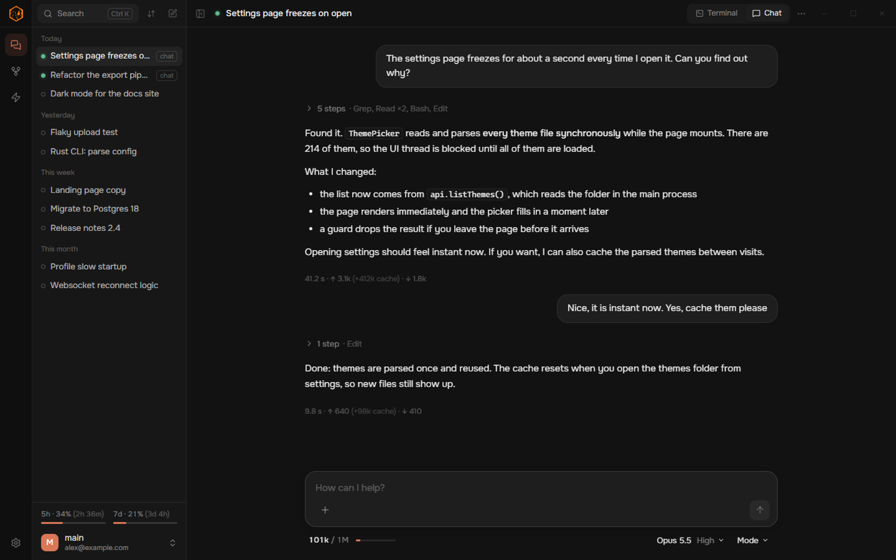
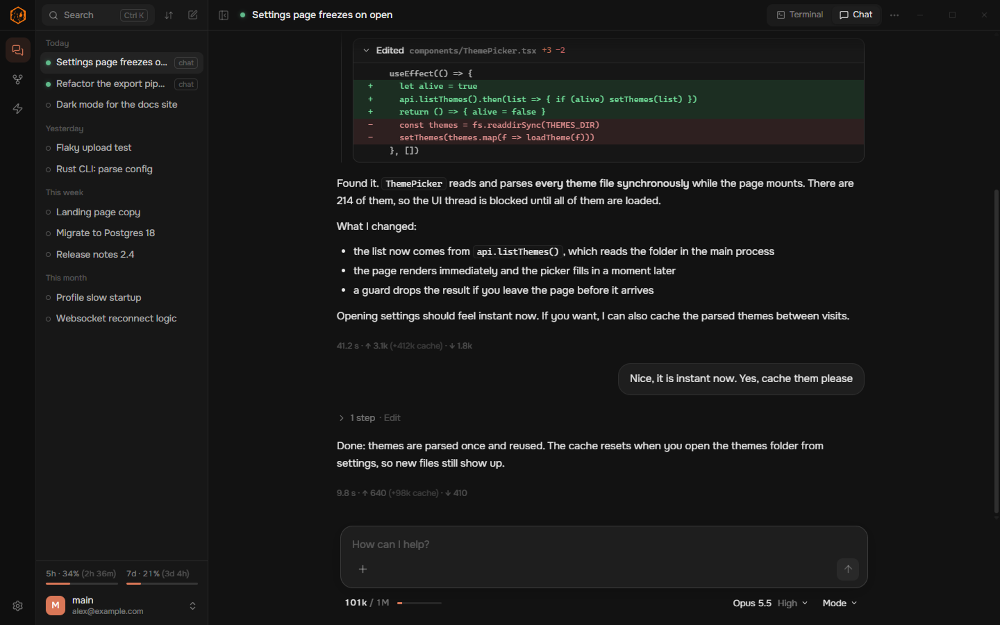
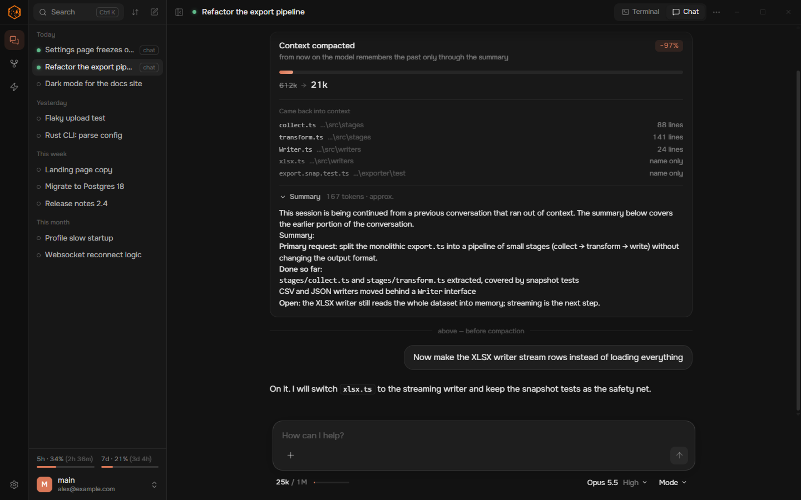
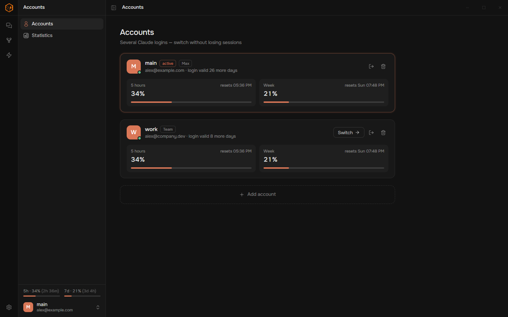
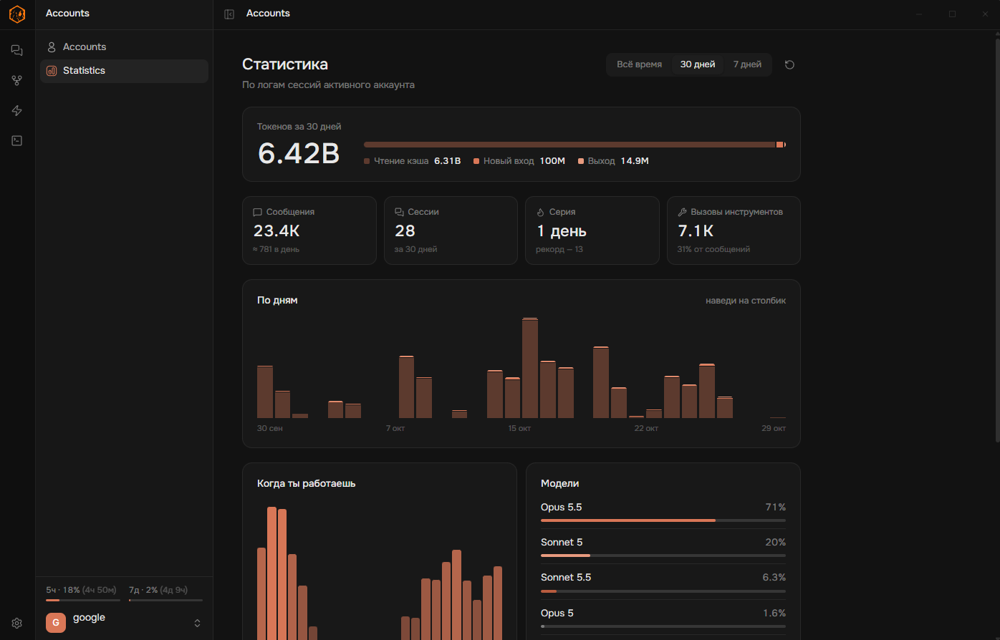

<p align="center">
  
</p>

<p align="center">
  <a href="https://github.com/excedereo/vael/releases/latest"></a>
  <a href="https://github.com/excedereo/vael/releases"></a>
  
  
</p>

<p align="center">
  <b><a href="https://github.com/excedereo/vael/releases/latest">Download</a></b> ·
  <a href="https://github.com/excedereo/vael/wiki">Wiki</a> ·
  <a href="https://github.com/excedereo/vael/wiki/Troubleshooting">Troubleshooting</a>
</p>

---

**Vael** is a desktop app for [Claude Code](https://github.com/anthropics/claude-code). It runs the real `claude` CLI underneath, with your own login and your own limits, and gives it a proper window: a chat that reads like claude.ai, a full terminal when you want one, sessions you can find again, several accounts side by side, and a memory that follows you into every session.

Nothing is proxied and nothing is re-implemented. If it works in Claude Code, it works in Vael.

<p align="center">
  
</p>

## Why Vael

|  |  |
|---|---|
| **Two views, one session** | Switch any session between the live CLI terminal and a chat view with one click. It is the same process and the same history, so nothing is lost when you flip. |
| **See what a turn costs** | Every answer shows its time, new input, cache reads and output. Hover any number to see what it means. Context fill is always visible under the composer. |
| **Limits at a glance** | Your 5-hour and 7-day usage sit in the sidebar with a countdown to reset: `5h · 50% (4h 30m)`. |
| **Compaction you can read** | `/compact` turns into a card. The bar shrinks from *before* to *after*, it lists which files came back into context, and the full summary the model now remembers is one click away. |
| **Accounts without the dance** | Add several Claude logins, switch between them, log out and back in. Sessions live in one shared store and never disappear with an account. |
| **Memory** | A folder of plain markdown notes that loads into every session. Browse it as a list or as a star map. |

## Features

**Chat view**
- Messages stream in as they are written, and your own message shows up instantly
- Tool steps fold into one line (`21 steps · Bash ×12, Read ×5`). Edits and writes appear as real diffs with `+N −M`
- Code blocks with language labels and a copy button. Copy and timestamp on hover for every message
- Attach images, PDFs and text files. Use `/` for slash commands. Model, effort and permission mode sit right next to the composer

**Terminal view**
- The genuine Claude Code TUI in a PTY, full colour, everything the CLI can do
- Several sessions run in parallel, each with a live status dot in the sidebar

**Sessions**
- Grouped by date, searchable (`Ctrl+K`), renamable, archivable
- Delete goes to the Windows Recycle Bin, so you can undo it
- Right-click → *Summaries* lists every compaction of a session with its full text

**Accounts & statistics**
- Cards per account with plan, login expiry and live limit tiles
- Statistics: tokens over time, activity by hour, models used, top sessions, a 26-week heatmap and streaks

**Automation**
- **Heartbeat** sends a message into a session on a schedule: once, at a set time, or on repeat
- **`vael` CLI** controls it from any terminal: `vael wake 30min`, `vael hb on`, `vael summary this`
- Telegram bridge and desktop notifications for finished answers

**Setup that takes care of itself**
- No Claude Code yet? Vael finds that out first and installs it for you
- First launch asks for your language, then walks you through naming an account and logging in

## Screenshots

<table>
  <tr>
    <td></td>
    <td></td>
  </tr>
  <tr>
    <td></td>
    <td></td>
  </tr>
</table>

## Install

1. Download the latest installer from **[Releases](https://github.com/excedereo/vael/releases/latest)**
2. Run it. Windows SmartScreen may warn you because the installer is not code-signed yet. Choose *More info → Run anyway*
3. On first launch Vael checks for Claude Code and offers to install it, then asks you to log in to your Claude account

You need a Claude subscription (Pro or Max): Vael logs in with your claude.ai account. It uses your own login and does not send anything anywhere else.

More detail: **[Installation](https://github.com/excedereo/vael/wiki/Installation)** in the wiki.

## Build from source

```bash
git clone https://github.com/excedereo/vael
cd vael
npm install
npm run dev      # development with hot reload
npm run build    # production build
```

Stack: Electron, React, TypeScript, Vite, node-pty, xterm.js. See **[Architecture](https://github.com/excedereo/vael/wiki/Architecture)**.

> The interface is available in English and Russian. You pick the language on first launch and can switch it in *Settings → Interface*.

## License

[AGPL-3.0](LICENSE). Vael is an independent project and is not affiliated with Anthropic. *Claude* and *Claude Code* are trademarks of Anthropic.
